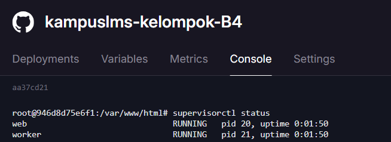

# Deployment KampusLMS

## 1. Deskripsi

KampusLMS (nama tampilan aplikasi: EduSpace) merupakan aplikasi **Learning Management System (LMS)** berbasis Laravel. Aplikasi dideploy ke platform Railway menggunakan Docker dan layanan MySQL Railway sebagai database production.

Dokumen ini menjelaskan deployment sesuai berkas yang benar-benar dipakai repo:

| Berkas | Fungsi |
| --- | --- |
| `Dockerfile` | Build image dua tahap (aset frontend, lalu aplikasi PHP) dan perintah startup (`CMD`). |
| `docker/supervisord.conf` | Konfigurasi Supervisor: menjalankan web server dan queue worker dalam satu container. |
| `.dockerignore` | Mencegah `.env`, `vendor`, `node_modules`, dan `public/build` lokal ikut masuk ke image. |
| `deploy.sh` | Skrip prosedur deploy ulang manual (maintenance, migrasi, cache, `queue:restart`, cek kesehatan). **Tidak dipanggil oleh Dockerfile.** |

Aplikasi menggunakan timezone **WITA (Asia/Makassar / UTC+8)**.

---

## 2. Teknologi yang Digunakan

- Laravel 12
- PHP 8.4 (image `php:8.4-cli`)
- MySQL (layanan Railway)
- Docker (multi-stage build)
- Supervisor
- Node.js 22 dan Vite (hanya pada tahap build)
- Composer
- Bash dan cURL (untuk pengujian)

---

## 3. Persiapan Project

Berkas yang dibutuhkan saat build image:

- `composer.json` dan `composer.lock`
- `package.json` dan `package-lock.json`
- `Dockerfile` dan `docker/supervisord.conf`
- Migration dan seeder database
- Konfigurasi Vite

Folder `public/build` tidak diambil dari repository (diabaikan oleh `.dockerignore` dan `.gitignore`). Folder ini selalu dibangun ulang di dalam image pada tahap build frontend.

---

## 4. Arsitektur Docker

### 4.1 Tahap 1: Build Aset Frontend (`node:22-slim`)

```dockerfile
FROM node:22-slim AS assets
WORKDIR /app
COPY package.json package-lock.json ./
RUN npm ci --no-audit --no-fund
COPY . .
RUN npm run build
```

Tahap ini hanya menghasilkan folder `/app/public/build`. Node.js dan `node_modules` **tidak ikut** ke image akhir.

### 4.2 Tahap 2: Aplikasi Laravel (`php:8.4-cli`)

Urutan langkah pada tahap kedua:

1. **Paket sistem dan ekstensi PHP.** Menginstal `supervisor`, `git`, `curl`, `zip`, `unzip`, dan library pendukung, lalu ekstensi PHP `pdo_mysql`, `mbstring`, `exif`, `pcntl`, `bcmath`, `gd`, dan `zip`.
2. **Composer.** Diambil dari image `composer:2`.
3. **Dependency produksi.** `composer.json` dan `composer.lock` disalin lebih dulu agar layer ini bisa di-cache Docker, lalu dijalankan:
   ```bash
   composer install --no-dev --no-scripts --no-autoloader --prefer-dist --no-interaction
   ```
   Paket pengembangan (`--no-dev`) tidak terpasang di production.
4. **Source aplikasi.** `COPY . .`
5. **Konfigurasi Supervisor.** `docker/supervisord.conf` disalin ke `/etc/supervisor/conf.d/supervisord.conf`.
6. **Aset frontend.** `public/build` disalin dari tahap 1 (`COPY --from=assets`).
7. **Autoloader.** `composer dump-autoload --no-dev --optimize --no-interaction`.
8. **Folder storage.** Membuat `storage/app/private`, `storage/framework/{cache,sessions,views}`, `storage/logs`, `bootstrap/cache`, lalu `chmod -R 775 storage bootstrap/cache`.
9. **Port.** `EXPOSE 8080`. Port sebenarnya ditentukan oleh variabel `PORT` dari Railway (lihat bagian 7.2).

Aplikasi **tidak menggunakan Apache**. Konfigurasi Apache sebelumnya menyebabkan konflik MPM (lihat 11.2) dan skrip startup lamanya (`docker/start.sh`) sudah dihapus dari repo.

---

## 5. Konfigurasi Environment Railway

Variabel environment utama pada Railway:

```env
APP_NAME=KampusLMS
APP_ENV=production
APP_KEY=base64:APP_KEY_LARAVEL
APP_DEBUG=false
APP_URL=https://${{RAILWAY_PUBLIC_DOMAIN}}

APP_TIMEZONE=Asia/Makassar

DB_CONNECTION=mysql
DB_HOST=${{MySQL.MYSQLHOST}}
DB_PORT=${{MySQL.MYSQLPORT}}
DB_DATABASE=${{MySQL.MYSQLDATABASE}}
DB_USERNAME=${{MySQL.MYSQLUSER}}
DB_PASSWORD=${{MySQL.MYSQLPASSWORD}}

SESSION_DRIVER=database
SESSION_SECURE_COOKIE=true

QUEUE_CONNECTION=database
CACHE_STORE=database

FILESYSTEM_DISK=local

LOG_CHANNEL=stack
LOG_STACK=single,stderr
LOG_LEVEL=error

DEMO_PASSWORD=PASSWORD_AKUN_DEMO
```

Catatan:

- `APP_KEY`, password database, dan `DEMO_PASSWORD` hanya diisi melalui **Variables Railway**, tidak pernah di-commit.
- `QUEUE_CONNECTION=database` wajib sama dengan yang dipakai worker (lihat 7.3).
- `DEMO_PASSWORD` wajib diisi pada production karena seeder berhenti jika nilainya kosong.
- `PORT` disediakan otomatis oleh Railway; tidak perlu diisi manual.
- Seluruh perubahan variabel memicu redeploy. Nilai config di-cache saat startup (`config:cache`), jadi perubahan variabel hanya berlaku setelah container dibuat ulang.

---

## 6. Konfigurasi Database

Aplikasi menggunakan layanan MySQL Railway. Migration dijalankan **otomatis pada setiap startup container** (bagian awal `CMD`):

```bash
php artisan migrate --force
```

Perintah ini hanya menerapkan migration yang belum dijalankan dan tidak menghapus data.

### 6.1 Seeder Database

Seeder **tidak dijalankan otomatis** pada startup. Hal ini mencegah data demo (misalnya akun pengguna) bertambah setiap kali deployment.

Untuk inisialisasi data pertama kali, jalankan secara manual dari shell service Railway (setelah `DEMO_PASSWORD` terisi):

```bash
php artisan db:seed --force
```

Lakukan sekali saja saat database baru. Jangan ulangi pada setiap deploy.

---

## 7. Menjalankan Aplikasi di Container

### 7.1 Perintah Startup (`CMD`)

Saat container menyala, Docker menjalankan rantai perintah berikut secara berurutan:

```bash
php artisan migrate --force
php artisan optimize:clear
php artisan config:cache
php artisan route:cache
php artisan view:cache
php artisan event:cache
exec supervisord -c /etc/supervisor/conf.d/supervisord.conf
```

Semua perintah dihubungkan dengan `&&`. **Jika salah satu gagal, container berhenti dan Supervisor tidak pernah berjalan.** Dua kegagalan yang paling mungkin:

- **`migrate` gagal**, misalnya database MySQL belum siap saat container pertama menyala. Tidak ada percobaan ulang otomatis di level `CMD`; Railway akan menjalankan ulang container sesuai kebijakan restart service. Cek variabel `DB_*` dan status service MySQL.
- **`route:cache` gagal** jika ada route yang tidak dapat di-cache (misalnya closure yang tidak bisa diserialisasi). `routes/web.php` memuat beberapa route berbentuk closure (`/`, `/tentang`, `/dashboard`, `/courses`). Pastikan build production benar-benar lolos pada tahap ini; periksa log deployment pertama setelah perubahan route. Jika ingin menjadikan `route:cache` opsional, ubah di `Dockerfile` secara eksplisit (misalnya `php artisan route:cache || true`) dan catat alasannya, bukan membiarkan kegagalan terjadi diam-diam.

`exec` membuat Supervisor menjadi proses utama (PID 1) container, sehingga sinyal stop dari Railway diterima Supervisor dan diteruskan ke proses anak.

### 7.2 Proses Web dan Konfigurasi Port Railway

Supervisor menjalankan web server melalui program `web`:

```ini
[program:web]
command=/bin/sh -c "php -S 0.0.0.0:${PORT:-8080} -t public"
```

- Railway menyuntikkan variabel `PORT`. Server PHP built-in mendengarkan pada nilai tersebut; jika `PORT` kosong (misalnya saat uji lokal) dipakai port `8080`.
- Document root adalah `public/`, sehingga `.env` dan source di luar `public/` tidak dapat diakses lewat HTTP.
- Pada service Railway, pastikan networking (domain publik) mengarah ke port yang sama dengan `PORT` yang dipakai container. Jika domain mengembalikan 502, cek apakah port target pada pengaturan domain cocok dengan port yang tampil di log (`Development Server (http://0.0.0.0:PORT) started`).
- Variabel opsional `PHP_CLI_SERVER_WORKERS` (tercantum di `.env.example`) mengatur jumlah worker server PHP built-in.

### 7.3 Proses Queue Worker

Program `worker` memproses job dari `QUEUE_CONNECTION=database`:

```ini
[program:worker]
command=php /var/www/html/artisan queue:work --sleep=3 --tries=3 --max-time=3600
```

| Opsi | Arti |
| --- | --- |
| `--sleep=3` | Jeda 3 detik saat antrean kosong. |
| `--tries=3` | Job dicoba maksimal 3 kali sebelum masuk `failed_jobs`. |
| `--max-time=3600` | Worker berhenti setelah 1 jam; Supervisor langsung menyalakannya kembali sehingga memori dan kode segar. |

Pengaturan Supervisor yang relevan: `autorestart=true` (proses yang mati dinyalakan ulang), `stopwaitsecs=60` (memberi waktu job yang sedang berjalan selesai sebelum dipaksa berhenti), serta `stopasgroup` dan `killasgroup` agar seluruh proses anak ikut dihentikan.

### 7.4 Log

Supervisor sendiri tidak menulis ke file log (`logfile=/dev/null`). Output program `web` dan `worker` diarahkan ke `stdout`/`stderr` container, sehingga seluruh log dapat dilihat di tab **Deployments → View Logs** Railway. Aplikasi Laravel juga menulis ke `stderr` melalui `LOG_STACK=single,stderr`.

---

## 8. Konfigurasi Routing

Route utama aplikasi diarahkan ke halaman login:

```php
Route::get('/', fn () => redirect()->route('login'));
```

Alur request:

```text
GET /        -> 302 Redirect
GET /login   -> 200 OK
```

Endpoint kesehatan bawaan Laravel tersedia di `/up` (dikonfigurasi pada `bootstrap/app.php`) dan dipakai untuk pemeriksaan setelah deploy.

---

## 9. Konfigurasi Timezone

```env
APP_TIMEZONE=Asia/Makassar
```

`Asia/Makassar` sesuai dengan WITA (UTC+8), sehingga waktu yang disimpan dan ditampilkan aplikasi sesuai waktu lokal.

---

## 10. Proses Deployment di Railway

1. Hubungkan repository ke Railway; Railway mendeteksi `Dockerfile` di root.
2. Buat service MySQL dan hubungkan variabel `DB_*` seperti pada bagian 5.
3. Isi seluruh Variables (termasuk `APP_KEY` dan `DEMO_PASSWORD`).
4. Railway membangun image: tahap 1 (build Vite), tahap 2 (dependency Composer production, source, aset, folder storage).
5. Container menjalankan `CMD`: migrasi, bersihkan dan buat ulang cache, lalu menjalankan Supervisor.
6. Supervisor menyalakan proses `web` (port `PORT`) dan `worker`.
7. Buat domain publik pada service, pastikan port target sesuai (bagian 7.2).
8. Jalankan verifikasi pasca-deploy (bagian 12).

Untuk deployment berikutnya, `git push` ke `main` memicu build dan container baru. Container lama diganti, sehingga worker baru otomatis memakai kode terbaru.

---

# 11. Permasalahan dan Solusi

## 11.1 Dockerfile Parse Error

Error awal:

```text
unknown instruction: libpng-dev
```

Penyebab: penulisan perintah `RUN` multi-baris tanpa backslash (`\`) yang benar.

**Solusi:** backslash pada setiap baris `RUN` diperbaiki.

---

## 11.2 Apache More Than One MPM Loaded

Pada deployment dengan Apache muncul error:

```text
AH00534: apache2: Configuration error: More than one MPM loaded.
```

**Solusi:** base image diganti dari PHP Apache menjadi `php:8.4-cli`, dan aplikasi dijalankan lewat server PHP built-in yang dikelola Supervisor. Skrip `docker/start.sh` yang berisi konfigurasi Apache (`/etc/apache2`) tidak lagi digunakan oleh Dockerfile dan telah dihapus dari repo agar tidak ada dua sumber instruksi startup yang bertentangan. Satu-satunya alur startup aktif adalah `CMD` di `Dockerfile` bersama `docker/supervisord.conf`.

---

## 11.3 Data Database Bertambah Setiap Deployment

Startup awal menjalankan `migrate` dan `db:seed` pada setiap container menyala, sehingga data demo (misalnya akun pengguna) terus bertambah.

**Solusi:** `db:seed` dikeluarkan dari startup. Startup hanya menjalankan `php artisan migrate --force`; seeder dijalankan manual satu kali (bagian 6.1).

---

## 11.4 Halaman Utama Menampilkan Welcome Laravel

Route `/` sebelumnya menampilkan `view('welcome')`.

**Solusi:** route diubah menjadi redirect ke halaman login (bagian 8).

---

## 11.5 Perbedaan Timezone

Waktu aplikasi sebelumnya UTC dan tidak sesuai waktu lokal.

**Solusi:** `APP_TIMEZONE=Asia/Makassar` (WITA, UTC+8).

---

# 12. Verifikasi Deployment

Lakukan langkah berikut setelah setiap deployment. Ganti `DOMAIN_APLIKASI` dengan domain publik Railway.

## 12.1 Status Proses (Supervisor)

Dari terminal service Railway (shell container):

```bash
supervisorctl status
```

Hasil yang diharapkan: program `web` dan `worker` berstatus `RUNNING`.

```text
web      RUNNING   pid ..., uptime ...
worker   RUNNING   pid ..., uptime ...
```



Jika salah satu berstatus `FATAL` atau terus restart, lihat log (12.2).

## 12.2 Pemeriksaan Log

Buka **Deployments → View Logs** pada Railway dan cari:

- `Nothing to migrate.` atau daftar migration yang berhasil: migrasi lolos.
- `INFO  Configuration cached successfully` dan `Routes cached successfully`: cache terbentuk (jika langkah ini gagal, container berhenti sebelum Supervisor jalan).
- `PHP 8.4.x Development Server (http://0.0.0.0:PORT) started`: web server aktif.
- Baris `[302]: GET /` dan `[200]: GET /login`: request diterima.
- Log `queue:work` / pemrosesan job: worker aktif.

## 12.3 Pemeriksaan HTTP dan Keamanan

```bash
curl -I https://DOMAIN_APLIKASI/up        # harapan: 200
curl -I https://DOMAIN_APLIKASI/login     # harapan: 200
curl -I https://DOMAIN_APLIKASI/          # harapan: 302 ke /login
curl -I https://DOMAIN_APLIKASI/.env      # harapan: 404 (atau 403), bukan 200
```

Pastikan juga: `APP_DEBUG=false`, `SESSION_SECURE_COOKIE=true`, aplikasi diakses lewat HTTPS, dan aset `/build/assets/*` termuat (tidak 404).

## 12.4 Verifikasi Queue Worker

Status `RUNNING` belum membuktikan job benar-benar diproses. Buat job nyata (misalnya aksi yang memicu notifikasi, seperti dosen memberi nilai) lalu periksa:

```bash
php artisan tinker --execute="echo DB::table('jobs')->count();"       # harapan: 0 setelah diproses
php artisan tinker --execute="echo DB::table('failed_jobs')->count();" # harapan: 0
```

Jumlah `jobs` yang tertahan di atas 0 dalam waktu lama menandakan worker tidak memproses antrean.

## 12.5 Redeploy dan `queue:restart`

Pada Railway, setiap deployment membuat container baru sehingga worker lama ikut diganti dan memakai kode terbaru. `php artisan queue:restart` hanya diperlukan jika kode diperbarui **tanpa** mengganti container (misalnya deploy ke VPS memakai `deploy.sh`). Skrip tersebut sudah memanggil `queue:restart` pada langkah 7/9 dan dapat dijalankan manual dengan `bash deploy.sh`.

> **Batasan verifikasi:** langkah 12.1 sampai 12.4 harus dijalankan langsung pada deployment Railway. Dokumen ini tidak menyatakan hasil build image lokal sebagai bukti deployment berhasil.

---

# 13. Pengujian API Production

Pengujian dilakukan terhadap API production KampusLMS yang telah dideploy di Railway.

Endpoint API berada pada format:

```text
https://DOMAIN_APLIKASI/api/v1
```

Script pengujian yang digunakan adalah:

```text
scripts/test-api.sh
scripts/test-authz.sh
```

Pengujian dilakukan menggunakan Git Bash dan `curl`.

---

## 13.1 Menentukan BASE_URL

Sebelum menjalankan pengujian, variabel `BASE_URL` harus diisi dengan URL API production.

Contoh:

```bash
export BASE_URL="https://DOMAIN_APLIKASI/api/v1"
```

Verifikasi nilai:

```bash
echo "$BASE_URL"
```

Contoh output:

```text
https://DOMAIN_APLIKASI/api/v1
```

---

## 13.2 Mendapatkan Token Authentication

Token diperoleh melalui endpoint login:

```text
POST /auth/login
```

### Admin

```bash
curl -s -X POST "$BASE_URL/auth/login" \
  -H "Content-Type: application/json" \
  -d '{"email":"admin@kampuslms.test","password":"PASSWORD"}'
```

Response:

```json
{
  "data": {
    "token": "TOKEN_ADMIN",
    "token_type": "Bearer"
  }
}
```

Simpan token sebagai environment variable:

```bash
export TOKEN_ADMIN="TOKEN_ADMIN"
```

---

### Dosen A

```bash
curl -s -X POST "$BASE_URL/auth/login" \
  -H "Content-Type: application/json" \
  -d '{"email":"dosen@kampuslms.test","password":"PASSWORD"}'
```

Simpan token:

```bash
export TOKEN_DOSEN_A="TOKEN_DOSEN_A"
```

---

### Dosen B

```bash
curl -s -X POST "$BASE_URL/auth/login" \
  -H "Content-Type: application/json" \
  -d '{"email":"EMAIL_DOSEN_B","password":"PASSWORD"}'
```

Simpan token:

```bash
export TOKEN_DOSEN_B="TOKEN_DOSEN_B"
```

---

### Mahasiswa

```bash
curl -s -X POST "$BASE_URL/auth/login" \
  -H "Content-Type: application/json" \
  -d '{"email":"mahasiswa@kampuslms.test","password":"PASSWORD"}'
```

Simpan token:

```bash
export TOKEN_MAHASISWA="TOKEN_MAHASISWA"
```

> Token asli tidak dimasukkan ke dalam repository atau dokumentasi.

---

## 13.3 Verifikasi Identitas Pengguna

Endpoint berikut digunakan untuk memastikan token berhasil dan sesuai dengan pengguna:

```text
GET /me
```

### Dosen A

```bash
curl -s "$BASE_URL/me" \
  -H "Authorization: Bearer $TOKEN_DOSEN_A"
```

### Dosen B

```bash
curl -s "$BASE_URL/me" \
  -H "Authorization: Bearer $TOKEN_DOSEN_B"
```

### Mahasiswa

```bash
curl -s "$BASE_URL/me" \
  -H "Authorization: Bearer $TOKEN_MAHASISWA"
```

Dari hasil pengujian, endpoint `/me` digunakan untuk memastikan:

- Token valid.
- Role pengguna sesuai.
- ID pengguna dapat diketahui.
- Email pengguna sesuai dengan akun yang digunakan.

---

# 14. Menentukan ID Data untuk Pengujian

Script pengujian membutuhkan beberapa ID data.

Variabel yang digunakan:

```bash
ID_TUGAS_DOSEN_A
ID_TUGAS_DOSEN_B
ID_SUBMISSION
```

---

## 14.1 Menentukan Course Dosen

Daftar course dapat diperoleh menggunakan:

```bash
curl -s "$BASE_URL/courses" \
  -H "Authorization: Bearer $TOKEN_DOSEN_A"
```

Untuk Dosen B:

```bash
curl -s "$BASE_URL/courses" \
  -H "Authorization: Bearer $TOKEN_DOSEN_B"
```

Dari response tersebut dapat diketahui course yang dimiliki oleh masing-masing dosen.

---

## 14.2 Menentukan Assignment Milik Dosen

Assignment dari suatu course dapat diperoleh dengan:

```bash
curl -s "$BASE_URL/courses/ID_COURSE/assignments" \
  -H "Authorization: Bearer $TOKEN_DOSEN_A"
```

Contoh:

```bash
curl -s "$BASE_URL/courses/1/assignments" \
  -H "Authorization: Bearer $TOKEN_DOSEN_A"
```

Dari hasil pengujian production, salah satu assignment milik Dosen A menggunakan:

```text
ID Assignment Dosen A = 1
```

Untuk Dosen B, assignment diperoleh melalui course milik Dosen B:

```bash
curl -s "$BASE_URL/courses/ID_COURSE_DOSEN_B/assignments" \
  -H "Authorization: Bearer $TOKEN_DOSEN_B"
```

Dari hasil pengujian, salah satu assignment milik Dosen B menggunakan:

```text
ID Assignment Dosen B = 11
```

ID tersebut digunakan untuk menguji pencegahan akses antar dosen.

---

## 14.3 Menentukan Submission

Daftar submission dari sebuah assignment dapat diperoleh menggunakan:

```bash
curl -s "$BASE_URL/assignments/ID_ASSIGNMENT/submissions" \
  -H "Authorization: Bearer $TOKEN_DOSEN_A"
```

Contoh:

```bash
curl -s "$BASE_URL/assignments/1/submissions" \
  -H "Authorization: Bearer $TOKEN_DOSEN_A"
```

Dari hasil tersebut dapat dipilih submission yang benar-benar berkaitan dengan assignment milik Dosen A.

Salah satu ID submission yang digunakan dalam pengujian adalah:

```text
ID Submission = 3
```

---

## 14.4 Mengatur Variabel ID

Setelah seluruh data ditemukan, variabel environment dapat diatur:

```bash
export ID_TUGAS_DOSEN_A=1
export ID_TUGAS_DOSEN_B=11
export ID_SUBMISSION=3
```

Verifikasi:

```bash
echo "$BASE_URL"
echo "$ID_TUGAS_DOSEN_A"
echo "$ID_TUGAS_DOSEN_B"
echo "$ID_SUBMISSION"
```

Pada pengujian production, nilai tersebut berhasil digunakan oleh kedua script pengujian.

---

# 15. Pengujian API

Script berikut digunakan:

```bash
bash scripts/test-api.sh
```

Script melakukan pengujian terhadap beberapa endpoint penting:

### POST `/assignments`

Pengujian meliputi:

- Request tanpa token.
- Mahasiswa mencoba membuat tugas.
- Dosen membuat tugas dengan data kosong.

### PUT `/assignments/{assignment}`

Pengujian meliputi:

- Request tanpa token.
- Mahasiswa mencoba mengubah tugas.
- Dosen A mencoba mengubah tugas milik Dosen B.
- Dosen A mencoba mengubah tugas miliknya dengan request kosong.

### PUT `/submissions/{submission}/grade`

Pengujian meliputi:

- Request tanpa token.
- Mahasiswa mencoba memberikan nilai.
- Dosen B mencoba menilai submission milik Dosen A.
- Dosen A menilai submission miliknya dengan request kosong.

---

## 15.1 Hasil Pengujian API

Hasil pengujian production menunjukkan:

| Pengujian | HTTP yang Diharapkan | Hasil |
|---|---:|---|
| POST assignment tanpa token | 401 | Lulus |
| Mahasiswa membuat assignment | 403 | Lulus |
| Dosen membuat assignment dengan form kosong | 422 | Lulus |
| PUT assignment tanpa token | 401 | Lulus |
| Mahasiswa mengubah assignment | 403 | Lulus |
| Dosen A mengubah assignment Dosen B | 403 | Lulus |
| Dosen A mengubah assignment miliknya dengan form kosong | 422 | Lulus |
| PUT grade tanpa token | 401 | Lulus |
| Mahasiswa memberikan nilai | 403 | Lulus |
| Dosen B menilai submission milik Dosen A | 403 | Lulus |
| Dosen A menilai submission dengan form kosong | 422 | Lulus |

Output akhir:

```text
Semua pengujian API berhasil.
```

---

# 16. Pengujian Authentication dan Authorization

Script berikut digunakan:

```bash
bash scripts/test-authz.sh
```

Pengujian dilakukan untuk memastikan mekanisme authentication dan authorization berjalan sesuai dengan role pengguna.

---

## 16.1 Akses Tanpa Token

Endpoint yang membutuhkan autentikasi harus menolak request tanpa token.

Pengujian meliputi:

```text
GET /courses
POST /assignments
```

Expected result:

```text
401 Unauthorized
```

Hasil:

```text
Lulus
```

---

## 16.2 Pembatasan Berdasarkan Role

Mahasiswa tidak diperbolehkan mengakses fitur yang hanya dapat digunakan oleh dosen.

Pengujian meliputi:

```text
POST /assignments
POST /grade-components
```

Expected result:

```text
403 Forbidden
```

Hasil:

```text
Lulus
```

---

## 16.3 Pencegahan IDOR Antar Dosen

Pengujian juga dilakukan untuk memastikan seorang dosen tidak dapat mengakses atau memodifikasi resource milik dosen lain.

Pengujian meliputi:

```text
Dosen A → Assignment milik Dosen B
Dosen B → Submission milik Dosen A
```

Expected result:

```text
403 Forbidden
```

Hasil:

```text
Lulus
```

Pengujian ini digunakan untuk memverifikasi pencegahan **Insecure Direct Object Reference (IDOR)** antar pengguna dengan role dosen.

---

## 16.4 Akses Valid Sesuai Hak

Pengujian dilakukan terhadap akses yang valid.

Hasil yang diperoleh:

```text
GET /courses → 200 OK
PUT assignment milik sendiri dengan form kosong → 422
PUT grade submission milik sendiri dengan form kosong → 422
```

Status `422` pada request kosong menunjukkan bahwa request telah berhasil melewati proses authentication dan authorization, kemudian ditolak oleh validasi data.

---

## 16.5 Akses Admin

Administrator diuji menggunakan endpoint:

```text
GET /courses
```

Expected result:

```text
200 OK
```

Hasil:

```text
Lulus
```

---

# 17. Hasil Akhir Pengujian Authorization

| Pengujian | HTTP yang Diharapkan | Status |
|---|---:|---|
| Request tanpa token | 401 | Lulus |
| Mahasiswa mengakses fitur dosen | 403 | Lulus |
| Mahasiswa membuat komponen nilai | 403 | Lulus |
| Dosen A mengubah data Dosen B | 403 | Lulus |
| Dosen B menilai submission milik Dosen A | 403 | Lulus |
| Dosen melihat course | 200 | Lulus |
| Dosen mengubah resource sendiri dengan request kosong | 422 | Lulus |
| Dosen menilai submission sendiri dengan request kosong | 422 | Lulus |
| Admin mengakses endpoint | 200 | Lulus |

Output akhir:

```text
Semua pengujian otorisasi berhasil.
```

---

# 18. Temuan Selama Pengujian

Pada pengujian awal ditemukan bahwa request kosong ke endpoint:

```text
PUT /assignments/{assignment}
```

sebelumnya mengembalikan:

```text
200 OK
```

Padahal script pengujian mengharapkan:

```text
422 Unprocessable Entity
```

Penyebabnya adalah validasi pada method `update()` menggunakan aturan:

```php
'sometimes'
```

yang memungkinkan request kosong tidak memiliki field yang perlu divalidasi.

Validasi kemudian diperbaiki agar request kosong tidak dianggap sebagai update yang valid.

Setelah perbaikan diterapkan dan deployment diperbarui, pengujian menghasilkan:

```text
Dosen A mengubah tugas miliknya dengan form kosong
Hasil : BERHASIL (HTTP 422)
```

Setelah itu, seluruh pengujian API dan authorization berhasil.

---

# 19. Status Deployment

Deployment KampusLMS berhasil dilakukan di Railway.

Konfigurasi deployment memastikan:

- Aplikasi Laravel dapat berjalan di Railway.
- Database MySQL terhubung dengan aplikasi.
- Migration dapat dijalankan pada deployment.
- Data database tidak dibuat ulang pada setiap deployment.
- Seeder tidak berjalan berulang kali saat container dimulai.
- Halaman utama diarahkan ke halaman login.
- Aset frontend berhasil dibangun menggunakan Vite.
- Aplikasi menggunakan timezone WITA.
- API production dapat diakses.
- Authentication menggunakan token berhasil diverifikasi.
- Authorization berdasarkan role berjalan.
- Pencegahan akses antar resource dosen berjalan.
- Pengujian API berhasil.
- Pengujian authentication dan authorization berhasil.

## Hasil Akhir

```text
Deployment          : BERHASIL
API Testing         : SEMUA BERHASIL
Authorization Test  : SEMUA BERHASIL
Database Migration  : BERHASIL
Routing             : BERHASIL
Timezone WITA       : BERHASIL
```

Dengan demikian, aplikasi KampusLMS telah berhasil dideploy dan diverifikasi pada lingkungan production Railway.